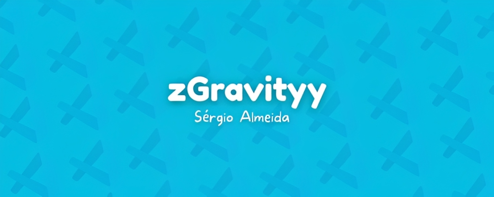
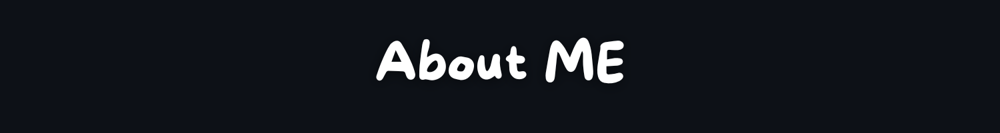
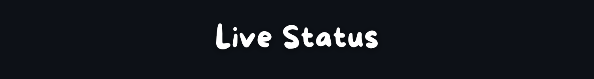
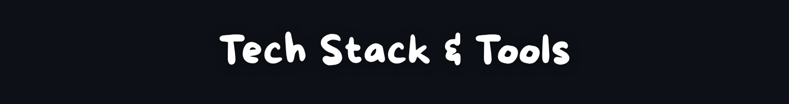
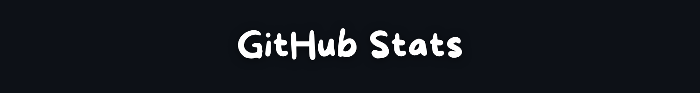
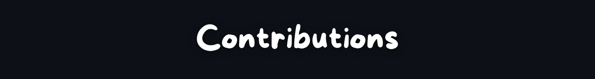
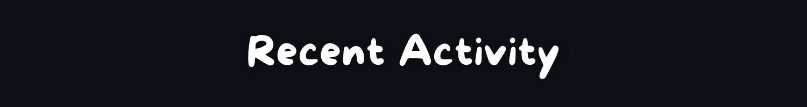
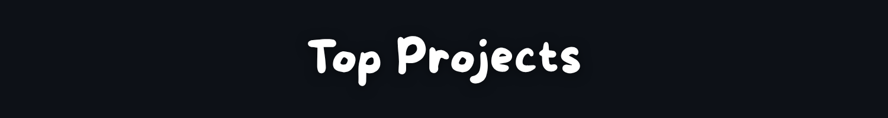
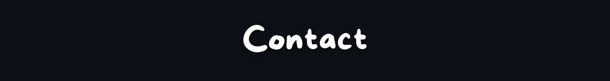

  
  
  

  <a href="#sobre-mim">Sobre Mim</a> &bull;
  <a href="#estado-atual">Estado</a> &bull;
  <a href="#tech-stack">Tech Stack</a> &bull;
  <a href="#estatisticas">Estatísticas</a> &bull;
  <a href="#atividade-recente">Atividade</a> &bull;
  <a href="#projetos">Projetos</a> &bull;
  <a href="#contacto">Contacto</a>

 

  

  

  

 

  

<table align="center" width="90%" border="0" cellpadding="20">
  <tr>
    <td width="65%" style="font-size: 18px; padding: 40px 20px;">
      <ul style="line-height: 1.8;">
        <li><b>Construindo:</b> Projetos e sistemas na <a href="https://zenstudios.online">Zen Studios</a></li>
        <li><b>Foco:</b> Front-End e Interfaces Web Modernas</li>
        <li><b>Base Técnica:</b> Fortalecendo fundamentos de Back-End (Python, C, APIs)</li>
        <li><b>Pergunte-me sobre:</b> Design Systems e Gestão de Servidores</li>
        <li><b>Portfólio:</b> <a href="https://www.zgravityy.xyz/">zgravityy.xyz</a> - <i>Acesse meu portfólio online para uma melhor experiência!</i></li>
      </ul>
    </td>
    <td width="35%" align="center" style="padding: 20px;">
      
    </td>
  </tr>
</table>

 

  

  

 

  

  

 

  

  
  

  

 

  

  <picture>
    <source media="(prefers-color-scheme: dark)" srcset="https://raw.githubusercontent.com/zGravity123/zGravity123/output/github-contribution-grid-snake-dark.svg">
    <source media="(prefers-color-scheme: light)" srcset="https://raw.githubusercontent.com/zGravity123/zGravity123/output/github-contribution-grid-snake.svg">
    
  </picture>

 

  

  

 

  

  

 

  

  
  

